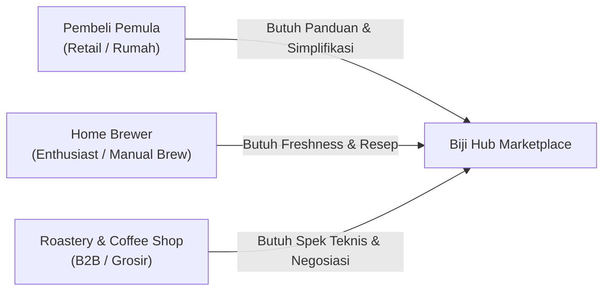

# Evaluasi Komprehensif UX, Fitur, & Desain Visual Biji Hub

> **Tanggal Evaluasi:** 19 November 2026  
> **Fokus Analisis:** User Experience (Pemula s/d Expert), Diagnosa Tipografi ("Font Jomplang"), Alur Transaksi, & Kesiapan Marketplace Kopi Nusantara  
> **Status:** Siap Ditinjau & Diimplementasikan

---

## 1. Executive Summary

Biji Hub memiliki fondasi teknis dan domain logic yang **sangat kuat dan kaya fitur**—bahkan melebihi marketplace umum karena memiliki fitur spesifik industri kopi specialty seperti *roast-to-ship SLA*, *brew calculator*, *perlindungan pembelian green beans*, *cupping sheet modal*, *tier harga grosir B2B*, dan *traceability lot petani*.

Namun, dari sisi **User Experience (UX) dan Desain Visual**, terdapat beberapa friksi krusial:
1. **Tipografi Mengalami "Font Clashing"**: Ada 3 jenis font dengan kepribadian yang saling bertabrakan (*Fraunces Serif*, *Plus Jakarta Sans*, dan *Space Mono*), sehingga tampilan terasa "jomplang", berat sebelah, dan kurang konsisten.
2. **Kesenjangan Bahasa untuk Pemula**: Istilah kopi specialty (*washed, anaerobic, cupping score, crop year, green beans*) sering kali belum memiliki bantuan penjelasan instan (tooltips/glosarium) bagi pembeli awam.
3. **Kompleksitas Multi-Toko**: Karena setiap roastery mengirim dari kotanya masing-masing (multi-origin), alur keranjang dan checkout memerlukan panduan visual yang lebih transparan agar pembeli tidak bingung saat pesanan diproses per toko.

---

## 2. Bedah Tuntas Masalah Font ("Kenapa Terasa Jomplang?")

Perasaan bahwa font terasa **"agak aneh dan jomplang"** adalah **diagnosa yang 100% tepat secara prinsip desain visual**.

### 2.1. Akar Masalah: Benturan 3 Font yang Berlawanan Karakter

Saat ini, di [app/layout.tsx](file:///D:/College/Technopreneurship/biji-corp/app/layout.tsx) dan [app/globals.css](file:///D:/College/Technopreneurship/biji-corp/app/globals.css), proyek mengimpor 3 font:
1. **Fraunces** (`font-display`): Font *Old-Style Variable Serif* dengan kurva tebal, organik, sedikit *chunky*, dan bernuansa retro editorial/majalah 1970-an.
2. **Plus Jakarta Sans** (`font-sans`): Font *Modern Geometric Sans-Serif* yang sangat bersih, netral, profesional, dan bergaya modern tech/SaaS.
3. **Space Mono** (`font-mono`): Font *Monospace/Mesin Ketik* lebar dengan spasi karakter kaku, bernuansa terminal developer atau nota receipt mentah.

### 2.2. Studi Kasus Nyata: 1 Kartu Produk Berisi 3 Font Sekaligus

Perhatikan apa yang terjadi pada [components/catalog/listing-card.tsx](file:///D:/College/Technopreneurship/biji-corp/components/catalog/listing-card.tsx):
* **Judul Produk**: `font-display` (Fraunces Serif) — *bergaya klasik-organik majalah.*
* **Harga Produk (`Rp 120.000`)**: `font-mono` (Space Mono) — *bergaya kodingan mesin ketik.*
* **Satuan & Nama Toko (`/ 250g`, `Roastery Demo`)**: `font-sans` (Plus Jakarta Sans) — *bergaya modern sans.*

```
┌────────────────────────────────────────────────────────┐
│  [Foto Produk]                                         │
│                                                        │
│  Gayo Bourbon Anaerobic Natural   <-- Fraunces (Serif) │
│  [Aceh] [Anaerobic]               <-- Jakarta (Sans)   │
│  Rp 145.000 / 250g                <-- Space Mono + Sans│
│  Roastery Demo • ★ 4.9            <-- Jakarta (Sans)   │
└────────────────────────────────────────────────────────┘
```

> [!WARNING]
> Dalam ruang berukuran 200–280 pixel pada sebuah kartu produk, mata pengguna dipaksa beralih membaca **Serif kurva lembut -> Monospace kaku -> Geometric Sans modern**. Transisi visual inilah yang menciptakan kesan **"jomplang"**, tidak harmonis, dan melelahkan mata (*cognitive visual friction*).

### 2.3. Rekomendasi Solusi Tipografi

Kami menyarankan 2 opsi solusi (Opsi A sangat direkomendasikan):

#### Opsi A: "Modern Unified Commercial" (Rekomendasi Utama)
* **Gunakan Plus Jakarta Sans untuk 95% UI**: Semua judul produk, tombol, label, menu dashboard, dan harga menggunakan Plus Jakarta Sans.
* **Gunakan `tabular-nums font-semibold` untuk Angka/Harga**: Angka harga e-commerce (`Rp 145.000`) menjadi rapi sejajar tanpa terlihat seperti font kodingan/monospace.
* **Batasi Fraunces HANYA untuk Hero Headline Terpilih**: Fraunces hanya dipakai pada 1-2 judul besar editorial (misalnya: tagline utama di beranda `"Bursa Kopi Specialty Nusantara"` dan halaman artikel cerita petani/kebun).
* **Dampak**: Website seketika terasa bersih, modern, selevel dengan Tokopedia/Apple/Stripe, dan jauh lebih profesional.

#### Opsi B: "Classic Coffee Roaster Journal"
* Jika ingin mempertahankan nuansa *craftmanship/artisan*, ganti Fraunces dengan font serif kontemporer yang lebih netral dan proporsional (misalnya: *Newsreader*, *Lora*, atau *Playfair Display* dengan bobot regular-medium yang elegan, bukan bold chunky).

---

## 3. Evaluasi UX Berdasarkan Spektrum Pengguna

Website Biji Hub melayani dua audiens dengan tingkat literasi kopi yang sangat kontras: **Pembeli Pemula (Retail)** dan **Expert / Pemilik Roastery & Coffee Shop (B2B)**.



### 3.1. Persona 1: Pembeli Pemula (Beginner / Kasual)

*Karakter: Suka ngopi di coffee shop, ingin seduh di rumah, belum hafal istilah teknis industri specialty.*

#### Kelebihan yang Sudah Ada:
* Adanya **Coffee Guide Wizard** (Pemandu 4 Langkah) dan **Taste Quiz** di beranda.
* Adanya **Peringatan Biji Mentah (Green Beans Guard)**: Pemula dicegah keliru membeli green beans berkat banner peringatan keras dan checkbox konfirmasi sebelum bisa checkout.

#### Area yang Masih Membingungkan:
1. **Jargon Cupping & Proses Pasca-Panen Tanpa Penjelasan**:
   * Di filter dan detail produk, istilah seperti *Anaerobic Slow Dry, Full Washed, Natural, Lactic, Honey* muncul begitu saja.
   * *Rekomendasi*: Tambahkan mikro-tooltip `(?)` atau kartu pemula: *"Washed = Rasa bersih & segar; Natural = Rasa manis buah pekat"*.
2. **Pilihan Ukuran Gilingan (Grind Size)**:
   * Dropdown gilingan sudah ada (*Kasar, Sedang, Halus*), namun pemula sering bingung alatnya (misal: punya Mokapot atau French Press harus pilih mana?).
   * *Rekomendasi*: Sertakan nama alat seduh di samping nama gilingan, misal: `Giling Halus (Espresso / Mokapot)`, `Giling Sedang (V60 / Filter)`, `Giling Kasar (French Press / Cold Brew)`.

---

### 3.2. Persona 2: Home Brewer & Enthusiast (Tingkat Menengah)

*Karakter: Sudah punya grinder dan V60, sangat peduli tanggal sangrai (roast date) dan profil rasa (tasting notes).*

#### Kelebihan yang Sudah Ada:
* Tampilan **Tasting Notes Chips** dan **Radar Flavor Profile**.
* **Freshness Badge**: Menghitung otomatis usia sangrai (*Fresh Roast*, *Peak Flavor 14–30 hari*).
* **Brew Calculator & Komunitas Resep Seduh** di halaman produk.

#### Area yang Perlu Diperbaiki:
1. **Filter Berdasarkan Usia Sangrai di Katalog**:
   * Di sidebar filter beranda, belum ada filter cepat *"Disangrai Minggu Ini"* atau *"Ready to Brew"*.
2. **Ketersediaan Sampel Kecil**:
   * Enthusiast sering ingin mencicipi 50g–100g sebelum membeli 250g atau 1kg. Tombol "Minta Sampel" saat ini lebih diarahkan ke pembeli B2B.

---

### 3.3. Persona 3: Expert, Pemilik Roastery, & Pembeli B2B

*Karakter: Membeli green beans karungan (30kg–60kg) atau roasted beans grosir untuk supply cafe bulanan.*

#### Kelebihan yang Sudah Ada:
* **B2B Tiered Pricing**: Potongan harga otomatis jika memesan dalam jumlah tertentu.
* **Kotak Negosiasi Grosir & Minta Sampel** di halaman detail produk.
* **Ketelusuran Lot Petani**: Ada data lot code, ketinggian kebun (mdpl), tahun panen, hingga kadar air (*moisture content*).

#### Area yang Perlu Diperbaiki:
1. **Kalkulator Pengiriman Kargo (Logistik Berat > 20kg)**:
   * Saat pembeli B2B membeli 50kg green beans, tarif kurir reguler (JNE Reguler / SiCepat) menjadi sangat mahal.
   * *Rekomendasi*: Sediakan opsi ekspedisi kargo (JTR / SiCepat Cargo / Dakota Cargo / Indah Logistik) khusus untuk produk kategori Green Beans dengan bobot besar.
2. **Faktur Pajak & Bukti Potong PPh 22**:
   * Pelaku usaha kedai kopi berbadan hukum (PT/CV) membutuhkan lampiran invoice formal untuk pembukuan. Tombol cetak invoice sudah ada, namun perlu opsi input NPWP perusahaan saat checkout.

---

## 4. Evaluasi Fitur, Tampilan, & Alur Transaksi

### 4.1. Beranda & Katalog

| Elemen | Kondisi Saat Ini | Masukan / Solusi UX |
| :--- | :--- | :--- |
| **Hero Promo Banner** | Menampilkan informasi visual kopi dengan teks putih tebal. | Sudah sangat baik. Perlu ditambah shortcut langsung *"Saya Baru di Dunia Kopi"* yang membuka Guide Wizard. |
| **Grid Kategori Pilihan** | 4 kategori: Green Beans, Roasted, Drip Bag, Alat. | Sangat informatif. Ikon dan subtitelnya jelas bagi pemula. |
| **Sidebar Filter** | Sticky di kolom kiri, berisi Origin, Proses, Roast Level, Kategori. | Sangat fungsional. Perlu tombol *"Reset Semua Filter"* yang lebih mencolok saat beberapa filter aktif. |
| **Sort Bar (Tokopedia Style)** | Pilihan urutkan: Paling Sesuai, Terbaru, Ulasan, Harga. | Rapih dan responsif. |

---

### 4.2. Halaman Produk (Product Detail Page)

| Elemen | Kondisi Saat Ini | Masukan / Solusi UX |
| :--- | :--- | :--- |
| **Galeri Foto & Video** | Carousel gambar dengan indikator thumbnail. | Tajam dan cepat. Tambahkan badge rasio perbesaran jika ada foto close-up penampakan green beans. |
| **Spesifikasi Teknis** | Menampilkan tabel rapi: Origin, Proses, Sangrai, Tgl Roast, Ketinggian. | Bersih dan padat. Ubah font label dari `font-mono` menjadi `font-sans` agar lebih lembut. |
| **Radar/Flavor Chart** | Visualisasi profil rasa (Acidity, Body, Sweetness, dll). | Salah satu fitur terbaik di Biji Hub. Sangat membantu baik pemula maupun pro. |
| **Sticky Bottom Bar** | Bar mengambang di mobile dengan tombol Chat, Keranjang, dan Beli Langsung. | Sudah mematuhi aturan touch target 44px (`coarse:min-h-11`). Sangat memudahkan transaksi di layar HP. |

---

### 4.3. Keranjang & Alur Checkout Multi-Toko

| Elemen | Kondisi Saat Ini | Masukan / Solusi UX |
| :--- | :--- | :--- |
| **Pengelompokan Toko** | Produk dikelompokkan berdasarkan toko asal (*Seller Card*). | Sudah benar karena kota asal pengiriman berbeda. |
| **Kejelasan Checkout Per-Toko** | Tombol checkout dan ringkasan telah disesuaikan agar menampilkan nama toko aktif (pasca-commit `4957715`). | Jauh lebih jelas. Pengguna tidak lagi kaget kenapa produk toko kedua tidak ikut dicheckout. |
| **Pilihan Kurir & Ongkir** | Memuat tarif real-time kurir JNE/SiCepat berdasarkan kota tujuan. | Sangat akurat. Jika kota belum diisi, ada notifikasi informatif yang membimbing pengguna. |
| **Metode Pembayaran** | Midtrans Snap (QRIS, VA, Kartu Kredit) + Panduan Transfer Bank. | Integrasi sudah siap untuk produksi begitu akun Midtrans disetujui. |

---

### 4.4. Dashboard Penjual (Seller Dashboard)

| Elemen | Kondisi Saat Ini | Masukan / Solusi UX |
| :--- | :--- | :--- |
| **Sidebar Navigasi** | Sidebar responsif dengan mode mengecil (*collapsed* w-16). Tombol expand telah dipindah ke footer bawah. | Header atas bersih dengan logo saja; tombol expand di footer bawah memudahkan penggunaan desktop. |
| **Form Tambah Produk** | Form dinamis: field sangrai otomatis sembunyi jika kategori Green Bean / Equipment. | Sangat fleksibel. Pemilihan varietas tanaman kopi dengan chip interaktif sudah berjalan mulus. |
| **Langganan & Boost** | Terintegrasi dengan Midtrans Snap untuk upgrade paket Growth / Business dan pembelian slot boost. | Alur pembayaran otomatis mengaktifkan status tier saat Midtrans settlement. |
| **Verifikasi NIB/KYC** | Halaman status verifikasi dokumen legalitas. | Memberi kepastian hukum bagi penjual kopi resmi. |

---

## 5. Runtutan Roadmap Perbaikan (Action Plan)

Berikut adalah daftar prioritas perbaikan yang dapat dieksekusi secara bertahap:

```mermaid
graph TD
    subgraph Fase 1: Quick Wins (Selesai)
        F1A["Standardisasi Tipografi (Plus Jakarta Sans & Tabular Nums) - Selesai"]
        F1B["Label Panduan Alat Seduh pada Pilihan Gilingan Kopi - Selesai"]
        F1C["Tombol Reset Filter yang Jelas pada Sidebar Katalog - Selesai"]
    end

    subgraph Fase 2: Edukasi & Pengalaman Transaksi (Selesai)
        F2A["Glosarium / Tooltips Istilah Kopi & Cupping - Selesai"]
        F2B["Katalog Desktop 5 Kolom & Verified Badge Ringkas - Selesai"]
        F2C["Checkout Keranjang Per-Toko Pola Tokopedia & Skor Rasa Opsional - Selesai"]
    end

    subgraph Fase 3: Logistik Kargo & Faktur B2B (Selesai - Ramping)
        F3A["Badge Rekomendasi Kargo B2B & Alert Paket Grosir >= 5kg - Selesai"]
        F3B["Input NPWP / Badan Usaha di Checkout & Cetak Faktur Resmi - Selesai"]
        F3C["Parent-Child Order: Dilewati (YAGNI, pola per-toko Tokopedia sudah optimal)"]
    end

    Fase 1 --> Fase 2 --> Fase 3
```

### Tabel Rangkuman Prioritas

| No | Komponen / Fitur | Tingkat Urgensi | Estimasi Upaya | Dampak pada Pengguna |
| :--- | :--- | :---: | :---: | :--- |
| **1** | **Harmonisasi Font**: Ganti `font-display` pada card title & `font-mono` pada harga menjadi `font-sans` tabular. | **Tinggi (P1)** | Cepat (1-2 jam) | Tampilan seketika hilang kesan "jomplang"-nya; terlihat profesional dan bersih. |
| **2** | **Label Panduan Gilingan**: Tambahkan nama alat pada dropdown (misal: *Giling Sedang - V60 / Drip*). | **Tinggi (P1)** | Cepat (30 menit) | Pemula tidak takut salah memilih varian gilingan kopi. |
| **3** | **Tooltip Istilah Kopi**: Tambahkan penjelasan ringkas saat hover/klik istilah *Honey, Anaerobic, Washed*. | **Sedang (P2)** | Sedang (1 hari) | Meningkatkan literasi pembeli dan konversi pembelian produk specialty. |
| **4** | **Pencarian Cerdas Pemula**: Sediakan filter preset rasa populer (*Cokelat Manis*, *Fruity Segar*, *Kental Mantap*). | **Sedang (P2)** | Sedang (1 hari) | Membantu pembeli yang belum hafal nama daerah kopi. |
| **5** | **Dukungan Kargo B2B**: Opsi tarif kargo untuk pesanan kuantiti besar (green beans karungan). | **Jangka Menengah (P3)** | Sedang (2 hari) | Menarik pembeli roastery besar untuk transaksi volume puluhan kilogram. |

---

## 6. Kesimpulan

Secara fungsional dan teknis, **Biji Hub adalah marketplace kopi specialty terlengkap dan paling matang di kelasnya**.

Masalah rasa "jomplang" yang Anda rasakan berasal dari **benturan gaya tipografi (Fraunces Serif vintage vs Space Mono vs Plus Jakarta Sans)**. Dengan menyederhanakan hierarki font menjadi berfokus pada **Plus Jakarta Sans** (menggunakan Fraunces hanya untuk headline cerita/editorial), website akan langsung tampak modern, mewah, dan serasi. Ditambah dengan panduan istilah bagi pemula, Biji Hub akan sangat ramah bagi penikmat kopi pertama kali sekaligus tetap menjadi bursa komprehensif bagi pemilik roastery profesional.
